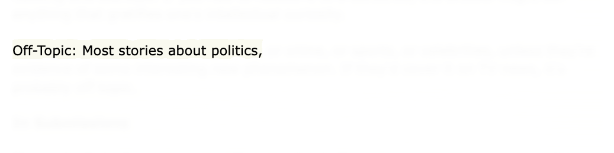

# redactor

Finds an erasure poem hidden in a web page, then covers everything else.

Pointed at the Hacksgiving rules page, it produced this:

```
as you want it to be. Your agent we
```

Ten syllables, iambic, and a true subsequence of Fly's own copy. 35,639 erasures of that page scan as pentameter. A model picked this one and said it "turns the page's product instructions into a quiet ending where 'Your agent' turns into 'we,' as if the tool you shape to your wishes ends up being you."

## Two it found

From [section 107 of the Copyright Act](https://www.copyright.gov/title17/92chap1.html), the fair use statute, which is the law deciding whether erasure poetry is legal at all. 184 words, 7,175 of whose erasures scan as pentameter:

```
commercial nature is unpublished shall
```

From [a tabletop blog arguing about how to end a session](https://theangrygm.com/ask-angry-journey-home/). 1,975 words of article, 187 of whose erasures are rhymed quatrains:

```
the heroes. And before you ask,
the answer is no; you
can’t just solve this with said: “I hold
my nose and I get through
```

Both are true subsequences of their page, in original order, with nothing added, and both were picked by a model from a sample drawn uniformly across the whole page rather than from the front of an enumeration.

An erasure keeps some of a source and deletes the rest. Nothing is added, nothing is reordered, and what survives stays where it was on the page. `redactor` enumerates every erasure of a page that satisfies a given form, ranks them, and renders the winner as a redacted screenshot.

## The problem it solves

A form alone is not a constraint worth having. The 43-word opening of _Moby-Dick_ contains 15,829,992,033 valid 5/7/5 erasures, and essentially all of them are word salad:

```
Call me Some never / how precisely, having no / me on thought a the
```

Two filters cut that to something a reader can be shown.

<!-- measured:constraints -->

Measured on the 43-word opening of _Moby-Dick_, counting 5/7/5 erasures. Trigrams are learned from the paragraph itself, as the tool does, giving a vocabulary of 40.

| constraint                 | candidates     |
| -------------------------- | -------------- |
| none                       | 15,829,992,033 |
| POS trigram                | 3,616          |
| contiguity, 3 runs         | 89,813         |
| contiguity, 2 runs         | 1,643          |
| contiguity 2 + POS trigram | 95             |

<!-- /measured:constraints -->

Contiguity is the one to keep. It cuts further on its own, it needs no model and no tagger, and the reason is better than the number: the source is already grammatical, so keeping its spans intact inherits its syntax outright. Part-of-speech transitions only check tag triples, a weaker proxy for the same thing, and one whose strength depends entirely on how much text the triples were learned from. That parameter went unstated the first time this table was written, which is why the caption carries it now.

Once the set is small enough to enumerate and read, a model never has to generate anything. It ranks. That removes invented words, miscounted syllables and reordered lines as possibilities rather than as bugs to catch.

## Use

```sh
redactor https://example.com/some-page
redactor https://example.com --form tanka --runs 3
redactor https://example.com --no-image        # text only, no screenshot
redactor https://example.com --no-llm --seed 7 # deterministic, no API calls
redactor https://example.com --style black     # bars instead of correction fluid
```

## Forms

`--form auto` is the default. It climbs to the hardest form the page will admit and tells you which one that was.

Difficulty here is measured, not asserted: it is how rarely a page admits the form at all, out of the erasures that fit it by syllable count.

<!-- measured:forms -->

Measured on [https://theangrygm.com/ask-angry-journey-home/](https://theangrygm.com/ask-angry-journey-home/), 1,975 words of article.

| form         | admits  | of        | shape                       |
| ------------ | ------- | --------- | --------------------------- |
| `quatrain`   | 0.03%   | 1,951,963 | 8/6/8/6, rhymed .A.A        |
| `couplet`    | 0.20%   | 5,007,538 | 10/10, rhymed AA            |
| `ballad`     | 3.52%   | 1,951,963 | 8/6/8/6, alternating stress |
| `pentameter` | 27.18%  | 5,900,413 | 10, alternating stress      |
| `tetrameter` | 36.86%  | 5,080,958 | 8, alternating stress       |
| `fib`        | 100.00% | 1,116,150 | 1/1/2/3/5/8                 |
| `cinquain`   | 100.00% | 1,587,247 | 2/4/6/8/2                   |
| `tanka`      | 100.00% | 1,113,366 | 5/7/5/7/7                   |
| `lune`       | 100.00% | 3,522,550 | 5/3/5                       |
| `haiku`      | 100.00% | 3,753,727 | 5/7/5                       |

Regenerate with `scripts/measure.py forms https://theangrygm.com/ask-angry-journey-home/`.

<!-- /measured:forms -->

The syllabic forms admit everything that fits them because they have no stress requirement to fail.

Ordering by difficulty buys more than a badge. A tight metrical form can only be satisfied by long contiguous spans, so its output inherits the source's grammar wholesale and reads better than a loose form's. Harder is not a trade against sense. It buys sense.

### Word-level shapes

`--shape snowball` and friends constrain which words survive and say nothing about lines, so the page supplies the layout.

`snowball` (each word a letter longer than the last), `univocalic:o`, `lipogram:e`, `abecedarian`, `chain`.

These sit at the bottom of the ladder and are only reached automatically when no form fits. A snowball is legible as a rule and almost never as a sentence:

```
a / it / the / week. / Start / Ollama / exactly / partners / connector / guidelines / Hacksgiving
```

## How it looks

Two styles. `black` lays an opaque bar over the erased words. `whiteout` is the default, and imitates correction fluid brushed over a printed page, after Mary Ruefle's _A Little White Shadow_: strokes dragged along the lines of type, ragged where they stop, thin in places so the covered words ghost through.


The fluid is mixed from the page rather than fixed. Sampling Ruefle's scan gives paper at `(237,212,188)` and fluid at `(244,240,242)`, so the rule is to take most of the color out of the background and raise its lightness. Applied to that same paper it returns `(245,243,241)`. That keeps the two in one family on any page, instead of dropping a white that belongs to no page onto a cream one or a dark one. `--fluid '#f5f3f1'` overrides it.

Hacker News reads `(250,250,240)`, so the fluid lands at white and the kept words stay on the cream the page already had. What is left of the covered text is the ghost showing through the thin places.



The fluid is never darker than the paper. Fluid sits on top of a page and catches more light than the page does, so mixing it darker reverses what the eye reads: the covered column turns into a wash, the paper around each surviving word turns into the brightest thing on the page, and the erasure looks applied to the words that were kept. Paper already at white gets fluid at white, and the stroke reads by its edges and its texture instead. A page can look blank where its words came out. It cannot look painted over the words that stayed.

Neither style draws only over the words that were erased. The whole text column is covered first and the surviving words are composited back, because anything OCR failed to read would otherwise stay on the page. The whiteout is not fully opaque, so what ghosts through is bounded two ways: the column is blurred before it is covered, and the fluid never thins past `GHOST_FLOOR`. What shows is a word's shape and none of its letters.

Coverage takes in every line whatever the poem keeps. Narrowing it to the lines the poem survives on is the cheap way to avoid rendering a lot of empty page, and it stops being an erasure: measured on an essay page, a one-line poem covered that way handed 255 of the page's 292 words back to OCR.

So the framing is decided separately, and it is the part that keeps the result a page. A poem drawn from a long article survives in a handful of lines. Cropped to those lines it is a strip two glyphs tall with nothing around it, and stretched from the first surviving line to the last it is mostly covering with nothing underneath, which is what one ballad gave when its two halves landed 2,000 pixels apart. The render keeps `CONTEXT_LINES` either side of every line the poem survives on, grows those runs outward until the image holds `PAGE_LINES` of type, and stacks them where the poem was spread too far for them to meet. A page with fewer lines than the floor is shown whole. A one-line poem still comes out a page.

Both styles take `--seed`, and the same seed renders the same page. That holds within one ImageMagick build. The noise generator is free to change between versions, so a seed is not a durable description of a render.

## Publishing

`--publish owner/repo` writes the result through the GitHub Sprites connector: the poem, the render, and the provenance to check it. From inside a Sprite the gateway identifies the caller by Fly's request signature, so no token is read, stored or passed.

With no `ANTHROPIC_API_KEY` the pipeline still completes. It picks arbitrarily from the candidate set, and the result is still form-correct and still readable. It just isn't chosen.

## Requirements

Python 3.11, plus `tesseract` and ImageMagick's `magick` for the rendered output, and a Chrome or Chromium binary for the screenshot. `--no-image` needs none of those.

Part-of-speech pruning is optional. Install `spacy` and `en_core_web_sm` to enable it. Without them the contiguity limit carries the pruning on its own.

## What does not work

Mesostics, acrostics and concrete verse cannot be erasures. An erasure may only delete, so it inherits the source's layout, while those forms need a constructed one: a mesostic wants its spine letters stacked at a single x position, and no page will supply that by accident. Measured on 506 words of a real page, a strict Cage mesostic with any vertical descent requirement has zero solutions.

Forms that constrain which words survive compose fine. Forms that dictate where words sit do not.
